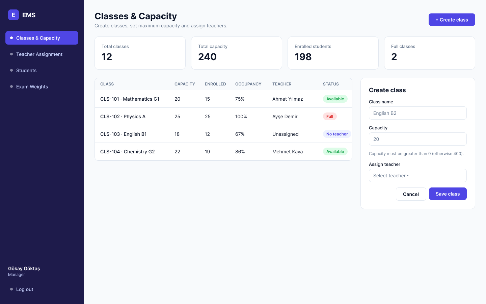
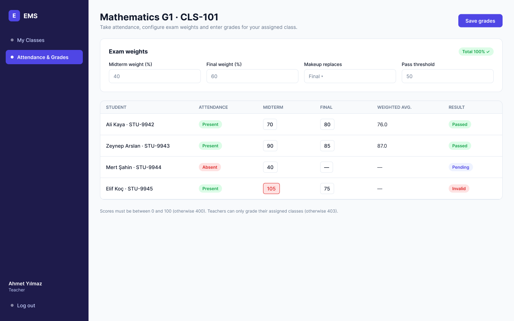
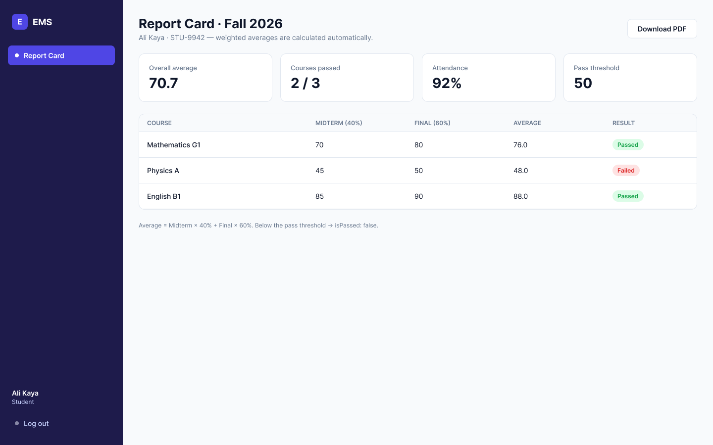
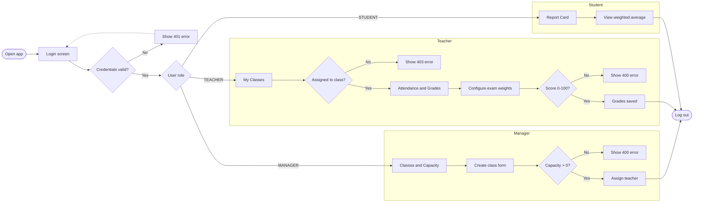

# UI/UX Prototypes and User-Flow Diagrams (S2-04)

**Sprint:** 2 – Requirements, UI/UX & Architecture
**Jira:** SCRUM-15 · **GitHub issue:** #14
**Owner:** Muhammed Ökmen (Implementation Engineer)

## Figma links (view-only)

| Artifact | Link |
| :--- | :--- |
| Design file (screens + components) | https://www.figma.com/design/owRoLeG6SQryYmi6nz5RNy |
| Clickable prototype (starts at Login) | https://www.figma.com/proto/owRoLeG6SQryYmi6nz5RNy?node-id=3-5&starting-point-node-id=3%3A5 |
| User-flow diagram (FigJam) | https://www.figma.com/board/3D3T8bv8pTcKKhDKpCCEPU |

Exported previews of every screen and the user-flow diagram are in this folder, so the deliverable can be reviewed without opening Figma.

---

## 1. Screens

All screens are desktop web layouts (1440 × 900) for the planned React front end. Each one maps to a user story and an endpoint in the OpenAPI contract (`api/seng321-project.yaml`).

| # | Screen | Role | User story | API |
| :--- | :--- | :--- | :--- | :--- |
| 01 | Login | All | US-01 | `POST /auth/login` |
| 02 | Classes & Capacity + Teacher Assignment | Manager | US-02 | `GET /classes`, `POST /classes` |
| 03 | Attendance & Grades + Exam Weight Configuration | Teacher | US-03 | `POST /students/{studentId}/grades` |
| 04 | Report Card | Student | US-04 | `GET /students/{studentId}/report-card` |

### 01 – Login

- Username and password form; on success the user lands on the screen for their role (MANAGER, TEACHER or STUDENT, taken from the JWT).
- A hidden error banner layer shows the **401 – Invalid username or password** state.
- The **Manager / Teacher / Student** shortcuts exist only to move through the prototype for each role.

### 02 – Manager: Classes & Capacity and Teacher Assignment

- Summary cards: total classes, total capacity, enrolled students, full classes.
- Class table with capacity, enrollment, occupancy, assigned teacher and status (Available / Full / No teacher).
- **Create class** panel: class name, capacity and teacher assignment. The helper text documents the rule *capacity must be greater than 0* (otherwise **400**).

### 03 – Teacher: Attendance, Exam Weights and Grade Entry

- Exam weight configuration: midterm %, final %, what the makeup exam replaces and the pass threshold. A badge confirms the weights add up to 100 %.
- Grade table: attendance (Present / Absent), midterm and final inputs, weighted average and result.
- Validation states: a score outside 0–100 (e.g. `105`) is highlighted and rejected (**400**). Teachers can only grade classes assigned to them (**403**).

### 04 – Student: Report Card

- Summary cards: overall average, courses passed, attendance and pass threshold.
- Per-course table: midterm (40 %), final (60 %), weighted average and Passed / Failed.
- Formula shown on screen: `average = midterm × 0.40 + final × 0.60`; below the threshold → `isPassed: false`.

---

## 2. Clickable prototype

Flow starting point: **EMS Prototype – Start at Login**.

| From | Click | Goes to |
| :--- | :--- | :--- |
| 01 Login | **Sign in** | 02 Manager |
| 01 Login | **Manager** | 02 Manager |
| 01 Login | **Teacher** | 03 Teacher |
| 01 Login | **Student** | 04 Student |
| 02 / 03 / 04 | **Log out** (sidebar) | 01 Login |

---

## 3. Role-based user flow

The same flow in Mermaid, so it can be read and versioned on GitHub:

---

## 4. Design system (in the Figma file)

**Color tokens** (Figma variables, collection `EMS Tokens`):

| Token | Value | Use |
| :--- | :--- | :--- |
| `color/primary` | `#4F46E5` | Primary actions, active navigation |
| `color/sidebar` | `#1E1B4B` | Sidebar background |
| `color/bg` / `color/surface` | `#F8FAFC` / `#FFFFFF` | Page and card backgrounds |
| `color/border` | `#E2E8F0` | Card, table and input borders |
| `color/text` / `color/text-muted` | `#0F172A` / `#64748B` | Body and secondary text |
| `color/success` / `color/danger` | `#16A34A` / `#DC2626` | Passed / Failed, validation errors |

**Reusable components:** `Button` (Primary / Secondary / Danger), `Input`, `NavItem` (Default / Active), `Badge` (Success / Danger / Neutral), `StatCard`. The screens use instances of these components, so the front end can map them one-to-one to React components.

**Typography:** Inter (Regular, Medium, Semi Bold, Bold).

---

## 5. Acceptance criteria (#14)

- [x] Key screens for all three roles built as clickable prototypes in Figma (Login, Manager classes/capacity and teacher assignment, Teacher attendance and grade/weight entry, Student report card).
- [x] Role-based user-flow diagram showing screen navigation, including the 401 / 403 / 400 error paths.
- [x] View-only Figma links, exported screen previews and the user-flow diagram added to the repository via pull request.
