# UI/UX Prototypes and User-Flow Diagrams (S2-04)

**Sprint:** 2 – Requirements, UI/UX & Architecture
**Jira:** SCRUM-15 · **GitHub issue:** #14
**Owner:** Muhammed Ökmen (Implementation Engineer)
**Version:** v2 – reworked after the Product Owner's review of v1 (see [section 2](#2-po-feedback--what-changed-in-v2))

## Figma links (view-only)

| Artifact | Link |
| :--- | :--- |
| Design file (page **"Prototype v2 (PO feedback)"**) | https://www.figma.com/design/owRoLeG6SQryYmi6nz5RNy |
| Clickable prototype v2 (starts at Login) | https://www.figma.com/proto/owRoLeG6SQryYmi6nz5RNy?node-id=76-1662&starting-point-node-id=76%3A1662 |
| Clickable prototype v1 (kept for history) | https://www.figma.com/proto/owRoLeG6SQryYmi6nz5RNy?node-id=3-5&starting-point-node-id=3%3A5 |
| User-flow diagram v1 (FigJam) | https://www.figma.com/board/3D3T8bv8pTcKKhDKpCCEPU |

Exported previews of all 15 screens and the v2 user-flow diagram are in this folder, so the deliverable can be reviewed without opening Figma.

**How to use the prototype:** click buttons, menu items and **Log out** to move between screens. The keyboard **→ / ←** arrows step through all 15 screens in order. The **Flows** list (top left in the prototype viewer) has a starting point for Login and for each role.

---

## 1. Screens

All screens are desktop web layouts (1440 × 900) for the planned React front end. Every screen has the same shell:
- a role-specific sidebar menu (aligned with the team's MOBS reference app; grey items are placeholders outside this prototype's scope);
- a top bar with the term, the signed-in user's profile (name, role, initials) and **Log out** at the top right.

| # | Screen | Role | Story / API (contract on `main`) |
| :--- | :--- | :--- | :--- |
| 01 | Login | All | US-01 · `POST /auth/login` |
| M1 | Dashboard | Manager | overview, quick actions |
| M2 | Users & Assignments | Manager | planned: user management |
| M3 | Create User (modal) | Manager | planned: user management |
| M4 | Courses & Teacher Assignment | Manager | US-02 · planned: teacher assignment |
| M5 | Classes & Capacity | Manager | US-02 · `GET /classes` (create class planned, #2) |
| M6 | Timetable Planner | Manager | planned: timetable |
| T1 | My Classes | Teacher | planned: teacher's classes and timetable |
| T2 | Class Detail | Teacher | US-03 |
| T3 | Create Exam (modal) | Teacher | US-03 · planned: exams and weights |
| T4 | Exam Grade Entry | Teacher | US-03 · `POST /students/{studentId}/grades` |
| T5 | Attendance | Teacher | US-03 · planned: attendance |
| S1 | Timetable | Student | planned: timetable |
| S2 | Exam Results | Student | US-04 · planned: per-exam results with class average |
| S3 | Report Card | Student | US-04 · `GET /students/{studentId}/report-card` |

"Planned" means the screen needs an endpoint that is not in `api/seng321-project.yaml` yet. These are listed so they can be added to the API contract in a later sprint.

### 01 – Login
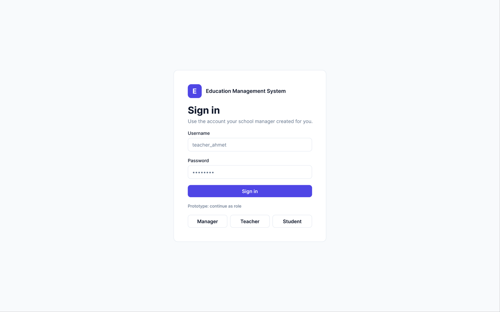

- Username and password. On success the user lands on their role's home screen (role taken from the JWT). A hidden layer shows the **401 – Invalid username or password** state.
- **Manager / Teacher / Student** buttons exist only to jump into each role in the prototype.

### Manager

**M1 – Dashboard:** summary cards, quick actions (create student / teacher, assign teacher to a class, plan timetable, manage classes), attendance-risk list and term status.
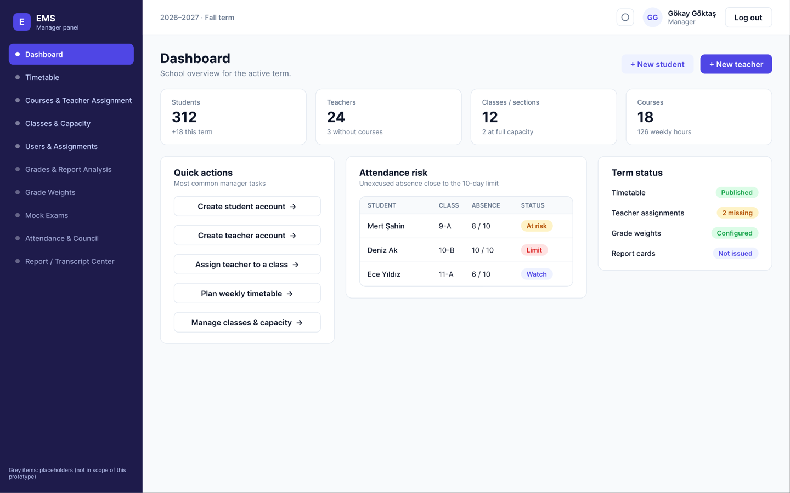

**M2 – Users & Assignments:** all accounts with role filters, search, status, *Reset password* and *Edit*. Old passwords are never shown; the manager sets a new one.
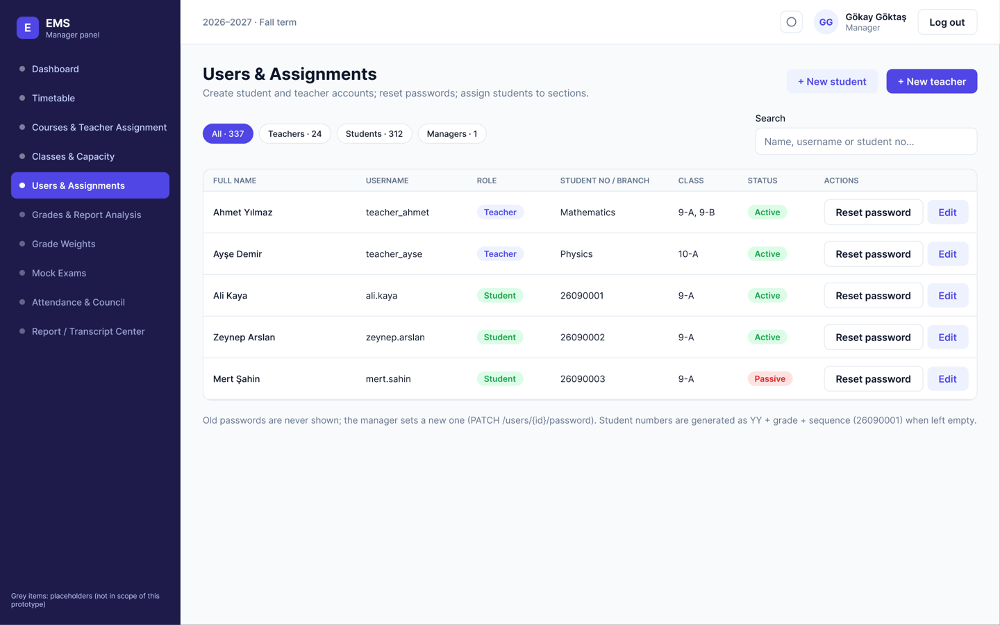

**M3 – Create User:** the manager creates student and teacher accounts (there is no self sign-up). Student numbers are generated automatically (e.g. `26090001`). Teachers get a *Branch* field instead of student number and class.
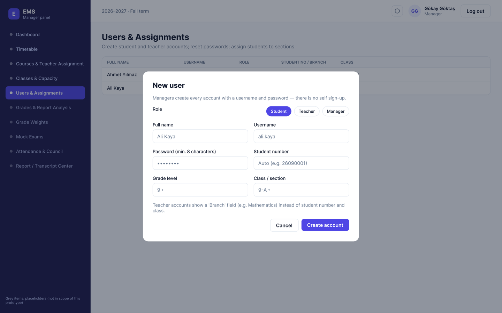

**M4 – Courses & Teacher Assignment:** courses with their teacher pool. The *Assign teacher to class* panel picks course, class and teacher, then sets **weekly hours** and **preferred days**. *Save & plan timetable* opens the planner.
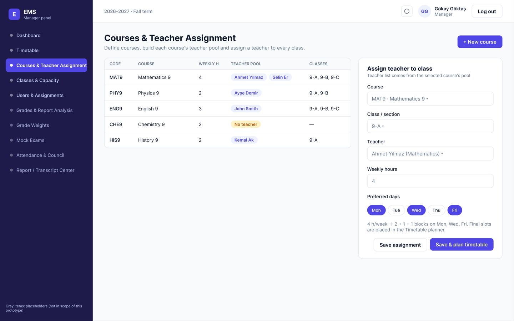

**M5 – Classes & Capacity:** sections with capacity, enrollment, room, homeroom teacher and status (Available / Full / No teacher). The *Create class* form documents the rule *capacity > 0* (otherwise **400**).
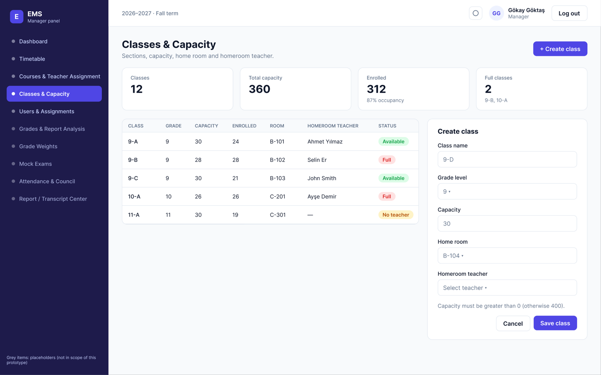

**M6 – Timetable Planner:** the assigned courses with placed / required hours, a weekly grid (Mon–Fri, 7 periods), and a conflict message when a teacher, class or room clash blocks a slot.
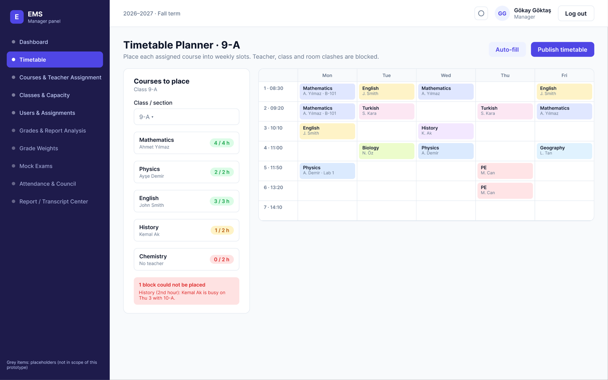

### Teacher

**T1 – My Classes:** the teacher's sections (with *Open class*), the selected section's students and the teacher's own weekly timetable.
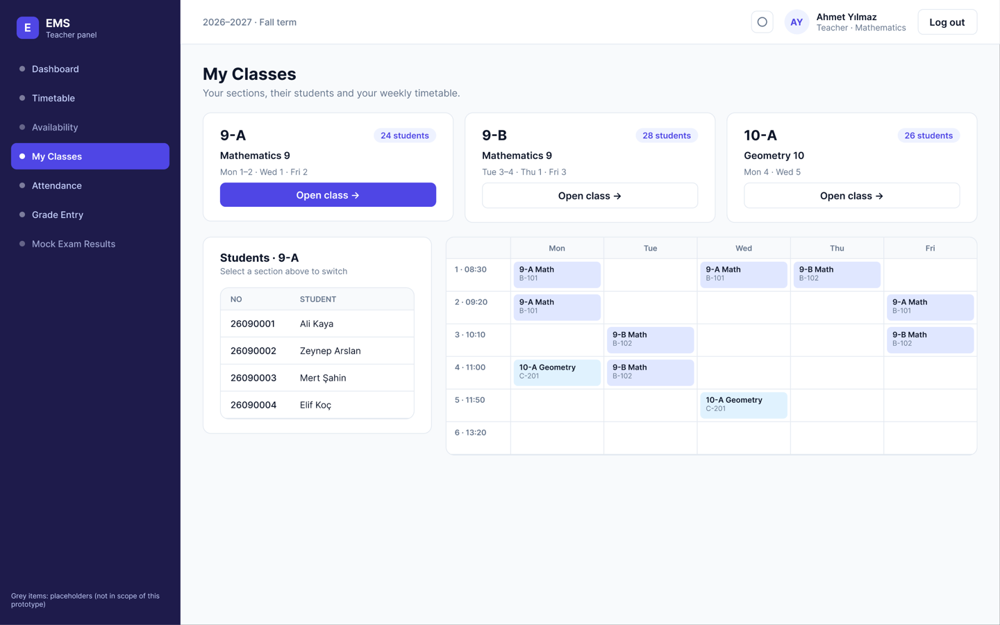

**T2 – Class Detail:** the exams of the class with their weights (total must be 100 %), grading progress, the student list and a **Create exam** button.
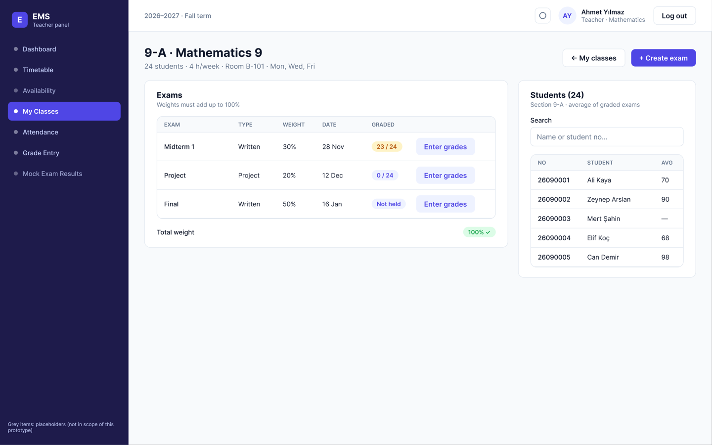

**T3 – Create Exam:** exam name, type, **weight (%)**, date, max score and class. A warning appears when the weights would no longer add up to 100 %. *Create & enter grades* goes to grade entry.
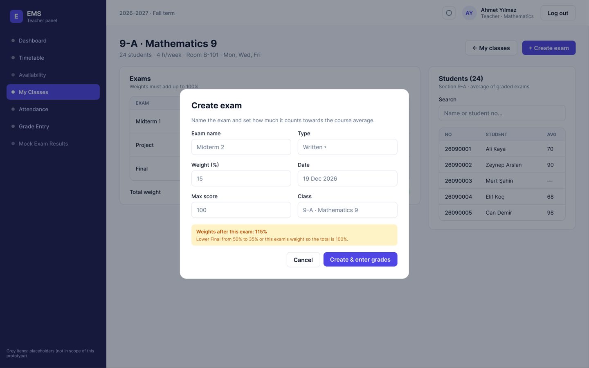

**T4 – Exam Grade Entry:** one score per student with attendance and save status. A score outside 0–100 (e.g. `105`) is rejected (**400**). Only the class's assigned teacher can grade (**403**). Students see a result once the teacher finalises it.
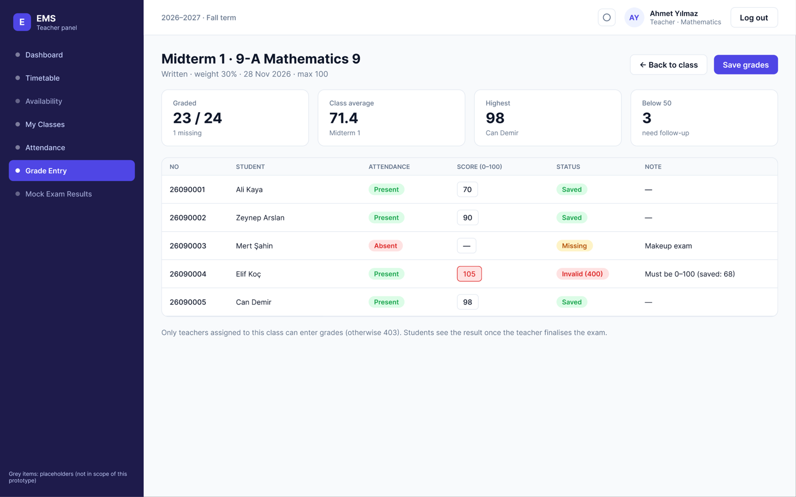

**T5 – Attendance:** class, date and period, then Present / Absent / Late / Excused per student, with total absence and an at-risk badge.
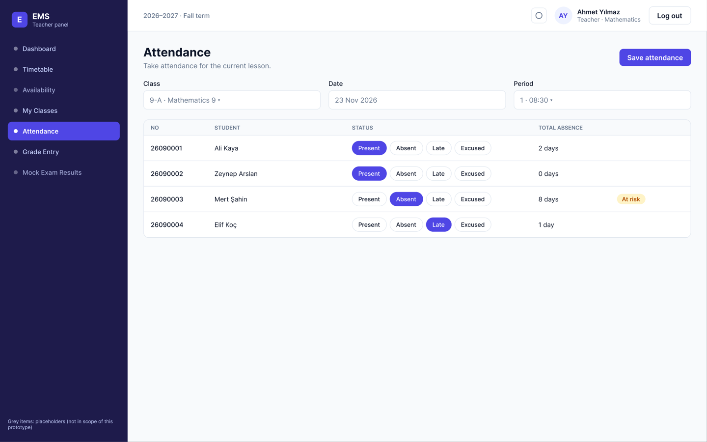

### Student

**S1 – Timetable:** the student's weekly timetable (course, teacher, room).
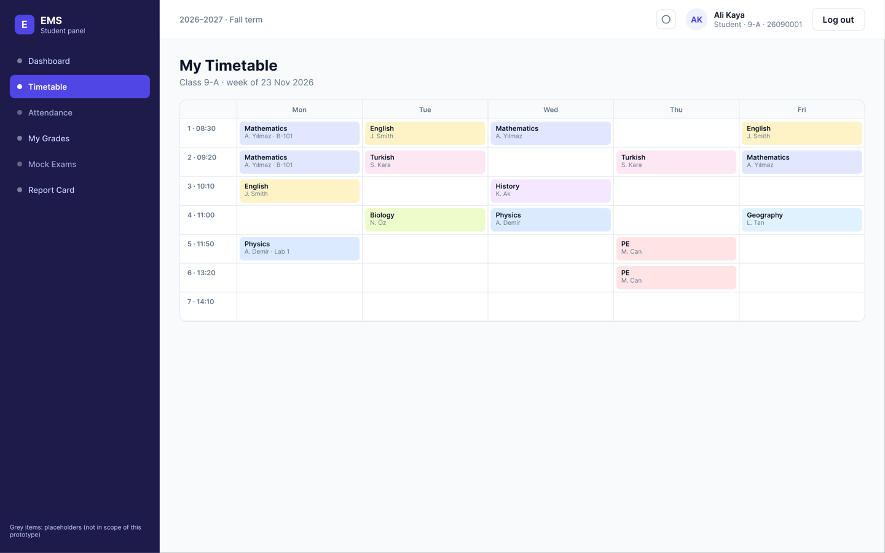

**S2 – Exam Results:** every **finalised** exam result shown **next to the class average** (bar comparison and difference). Exams that are not finalised show as *Pending*.
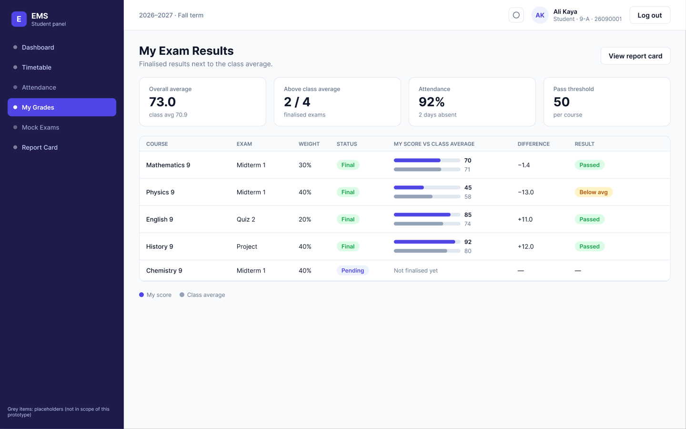

**S3 – Report Card:** per-course average calculated from the **per-exam weights the teacher sets** (T3, total 100 %) — the same weights shown in T2 and S2, not a fixed midterm/final split. Formula: `average = Σ(score × weight) ÷ Σ(weights of finalised exams)`. The card is provisional until every exam of a course is finalised; then `isPassed` is set (below the threshold → `false`). Each row shows the exam weights, what is finalised so far, the average and the **class average**.
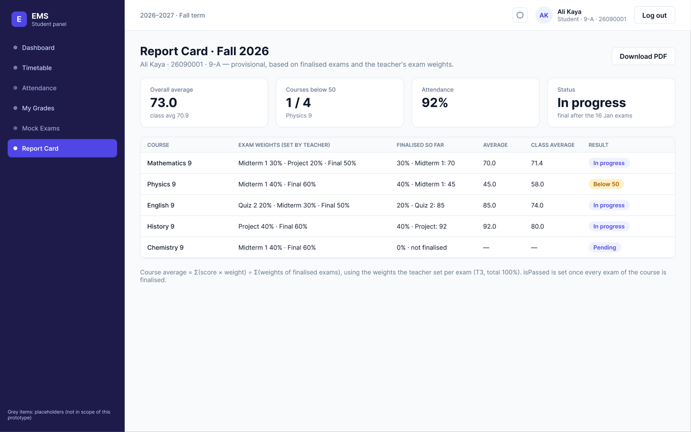

---

## 2. PO feedback → what changed in v2

The Product Owner (Gökay) reviewed v1 on Jira (SCRUM-15) and asked for the following. Each point is covered in v2:

| Feedback | Where in v2 |
| :--- | :--- |
| Profile and **Log out** at the top right | Top bar on every screen (name, role, initials, Log out → Login) |
| Fuller role menus (placeholders are fine) | Sidebars follow the MOBS reference menus; out-of-scope items are greyed placeholders |
| Student: timetable | S1 |
| Student: finalised exam results next to the class average | S2 (and a class-average column in S3) |
| Teacher: open a class → **Create exam** | T1 → T2 → T3 |
| Teacher: exam with name and percentage, then enter grades | T3 (name, weight %, 100 % check) → T4 |
| Teacher: sections, students and own timetable in My Classes | T1 |
| Manager: create students and teachers | M1 quick actions, M2, M3 |
| Manager: assign teachers to classes | M4 |
| Manager: weekly hours and days for the timetable | M4 (weekly hours, preferred days) → M6 |

This also settles the v1 review question about who owns exam weights: the **teacher** sets each exam's weight when creating it (T3). The manager menu keeps *Grade Weights* only as a placeholder.

---

## 3. Clickable prototype – main paths

| From | Click | Goes to |
| :--- | :--- | :--- |
| 01 Login | **Sign in** / **Manager** | M1 Dashboard |
| 01 Login | **Teacher** | T1 My Classes |
| 01 Login | **Student** | S2 Exam Results |
| M1 / M2 | **+ New student**, **+ New teacher**, quick actions | M3 Create User, M4, M5, M6 |
| M3 | **Create account** / **Cancel** | M2 Users |
| M4 | **Save & plan timetable** | M6 Timetable Planner |
| T1 | **Open class** | T2 Class Detail |
| T2 | **+ Create exam** | T3 Create Exam |
| T3 | **Create & enter grades** | T4 Grade Entry |
| T2 | **Enter grades** | T4 Grade Entry |
| T4 | **Save grades** / **Back to class** | T2 Class Detail |
| S2 | **View report card** | S3 Report Card |
| Any screen | Sidebar menu items | That role's screens |
| Any screen | **Log out** (top right) | 01 Login |

---

## 4. Role-based user flow

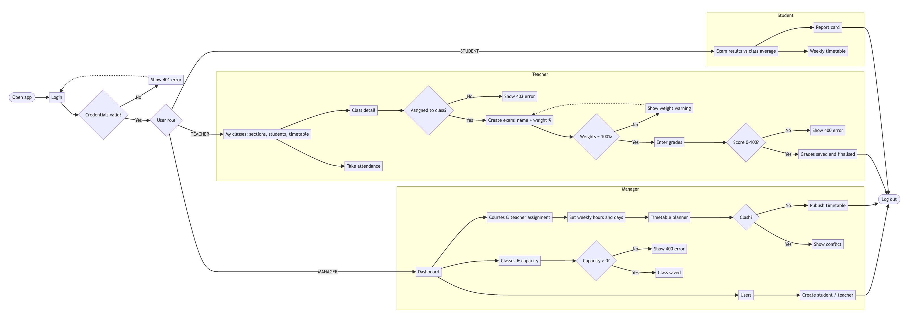

The same flow in Mermaid, so it can be read and versioned on GitHub:

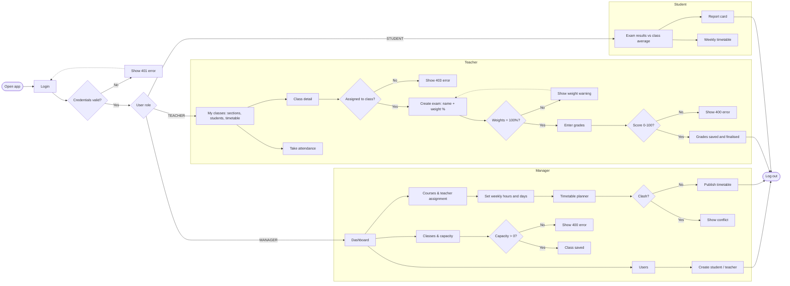

---

## 5. Design system (in the Figma file)

**Color tokens** (Figma variables, collection `EMS Tokens`):

| Token | Value | Use |
| :--- | :--- | :--- |
| `color/primary` | `#4F46E5` | Primary actions, active navigation |
| `color/sidebar` | `#1E1B4B` | Sidebar background |
| `color/bg` / `color/surface` | `#F8FAFC` / `#FFFFFF` | Page and card backgrounds |
| `color/border` | `#E2E8F0` | Card, table and input borders |
| `color/text` / `color/text-muted` | `#0F172A` / `#64748B` | Body and secondary text |
| `color/success` / `color/danger` / `color/warning` | `#16A34A` / `#DC2626` / `#B45309` | Passed / Failed / warnings |

**Reusable components** (page "Prototype v2", frame *Components v2*):
- `Button` (Primary / Secondary / Ghost / Danger)
- `Input`
- `NavItem` (Default / Active)
- `Badge` (Success / Danger / Neutral / Warning)
- `StatCard`
- `TopBar` (Name / Role / Initials properties, Log out)

The screens use instances of these components, so the front end can map them one-to-one to React components.

**Typography:** Inter (Regular, Medium, Semi Bold, Bold).

---

## 6. Acceptance criteria (#14)

- [x] Key screens for all three roles built as clickable prototypes in Figma: 15 screens covering login, manager user / class / teacher-assignment / timetable management, teacher classes / exams / grades / attendance, and student timetable / results / report card.
- [x] Role-based user-flow diagram showing screen navigation, including the 401 / 403 / 400 error paths.
- [x] View-only Figma links, exported screen previews and the user-flow diagram added to the repository via pull request.
