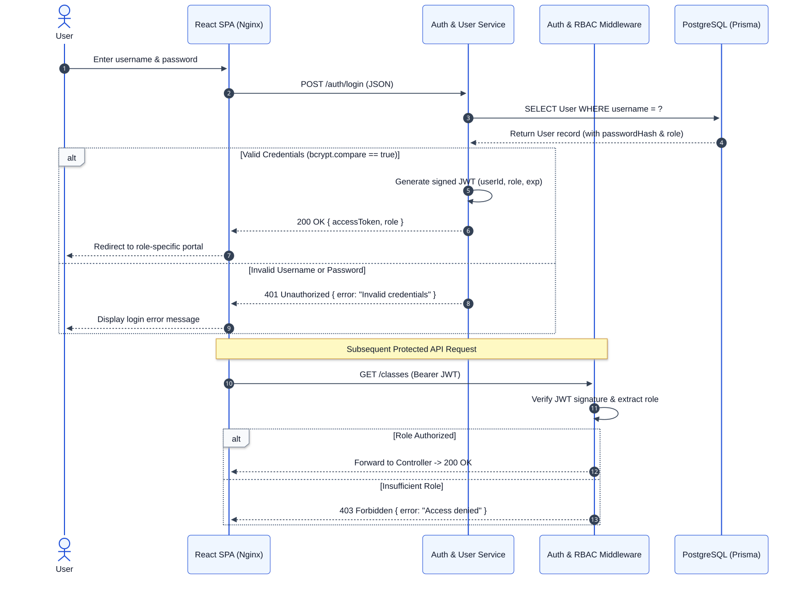
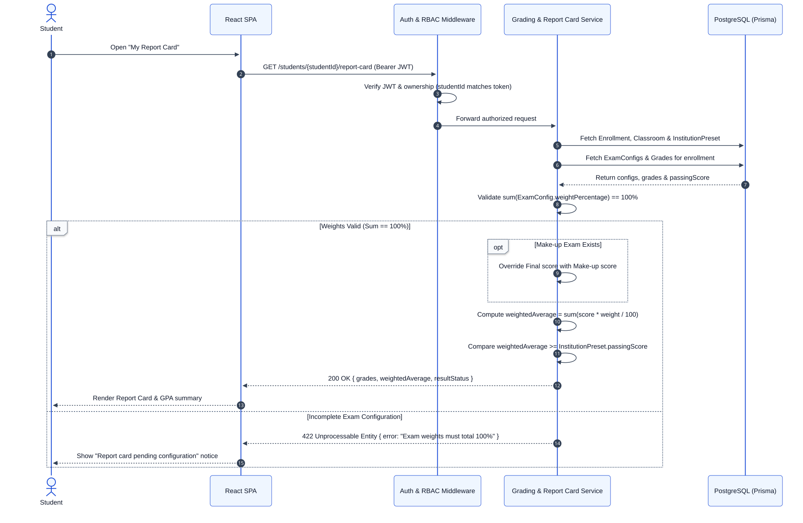

# Software Architecture Documentation – Education Management System

**Course:** SENG321 Software Engineering (Sprint 2 – Requirements & Architecture)  
**Author:** Berkay Kervan (Lead Software Architect)  
**Jira / Issue Reference:** S2-03  
**Last Updated:** November 2026

---

## 1. System Overview & Architectural Style

The **Education Management System (EMS)** is a web-based academic management platform serving three distinct user roles: **Administrator**, **Teacher**, and **Student**. The system covers local authentication and role-based access control (RBAC), institution setup presets, classroom and capacity management, teacher availability and hybrid scheduling, daily attendance tracking, mock exam templates, flexible exam weighting, and automated report card generation. Out-of-scope domains (accounting/billing, SMS notifications, and live online video classes) are intentionally excluded.

### Architectural Style
The system adopts a **Modular Monolith** organized as a **Layered Architecture (Controller → Service → Repository/ORM)** with an **API-First REST** design:
- **Decoupled Presentation & Business Logic:** The React Single-Page Application (SPA) communicates exclusively with the Node.js REST API via JSON over HTTPS.
- **Domain Modularity:** Backend responsibilities are isolated into cohesive domain services (`Auth & User`, `InstitutionPreset`, `Classroom & Enrollment`, `Scheduling`, `Attendance`, `MockExam`, and `Grading & Report Card`) sharing a single transactional PostgreSQL database.
- **Data Integrity First:** Critical operations such as classroom seat allocation execute within ACID database transactions to guarantee consistency under concurrent access.

---

## 2. Technology Stack & Rationale

| Layer | Technology | Rationale |
| :--- | :--- | :--- |
| **Frontend Web App** | React (SPA) + Nginx | Component-based UI architecture for role-specific dashboards; Nginx serves static production bundles efficiently and acts as a reverse proxy. |
| **Backend API** | Node.js + Express | Lightweight, non-blocking I/O runtime with a mature middleware ecosystem for REST routing, validation, and JWT/RBAC enforcement. |
| **ORM / Data Access** | Prisma ORM | Type-safe query generation, declarative schema migrations, and clean transactional API (`$transaction`) aligned directly with PostgreSQL. |
| **Database** | PostgreSQL | ACID-compliant relational database ideal for strict foreign-key integrity, composite constraints, and concurrency-safe seat capacity checks. |
| **Containerization** | Docker & Docker Compose | Guarantees portable, reproducible single-command local and staging deployments across all developer environments. |
| **Security** | JWT + bcrypt | Stateless role-bearing session tokens combined with salted password hashing for local authentication. |

---

## 3. C4 Architecture Models

### 3.1 Level 1 – System Context Diagram
Illustrates the external actors interacting with the Education Management System within the defined project scope.

### 3.2 Level 2 – Container Diagram
Details the runtime containers orchestrated via Docker Compose and their communication protocols.

### 3.3 Level 3 – Component Diagram (Backend API)
Decomposes the Backend API container into middleware, domain services, and the Prisma data access layer.

### Backend Component Responsibilities

| Component | Responsibility |
| :--- | :--- |
| **Auth & RBAC Middleware** | Validates incoming `Bearer` JWT signatures, extracts user identity/role, and blocks unauthorized access (`HTTP 401` / `HTTP 403`). |
| **Auth & User Service** | Handles local login, `bcrypt` password verification/hashing, and Administrator user management. |
| **InstitutionPresetService** | Powers the Setup Wizard by storing and applying institution-level academic defaults (institution type, academic term, passing score). |
| **Classroom & Enrollment Service** | Manages classroom definitions, teacher assignments, and concurrency-safe student enrollments with transactional capacity checks. |
| **SchedulingService** | Coordinates teacher availability declarations and hybrid schedule slot generation with manual override support. |
| **Attendance Service** | Records and retrieves daily attendance logs linked to active student enrollments. |
| **MockExamService** | Manages reusable mock exam templates (question counts and section structures) aligned with institution presets. |
| **Grading & Report Card Service** | Enforces flexible exam weight validation (`sum = 100%`), applies make-up exam override rules, and computes weighted averages and pass/fail status. |
| **Data Access Layer (Prisma ORM)** | Encapsulates type-safe SQL queries, relational joins, and PostgreSQL ACID transactions. |

---

## 4. UML Models & Domain Rules

### 4.1 UML Use-Case Diagram
Summarizes role-based system capabilities, mandatory authentication dependencies (`«include»`), and optional make-up exam overrides (`«extend»`).

### 4.2 UML Class Diagram (Domain & Data Model)
Represents the relational domain entities mapped to Prisma models and PostgreSQL tables, including the core academic entities and the extended modules (`InstitutionPreset`, `TeacherAvailability`, `ScheduleSlot`, and `MockExamTemplate`).

#### Key Domain Invariants
1. **Capacity Integrity (No Double-Booking):** Before inserting an `Enrollment`, `Classroom & Enrollment Service` checks current enrollment count against `Classroom.capacity` inside a PostgreSQL transaction; full classrooms reject new enrollments with `HTTP 409 Conflict`.
2. **Exam Weight Validation:** For any `Classroom`, the sum of `ExamConfig.weightPercentage` across active exams must equal `100%` before a final `ReportCard` is calculated (otherwise returning `HTTP 422 Unprocessable Entity`).
3. **Make-up Exam Rule:** If a student has a recorded make-up grade (`Grade.isMakeUp = true`), the make-up score overrides the standard final exam score during weighted average calculation.
4. **Hybrid Scheduling Constraints:** `ScheduleSlot` entries reference `Classroom` schedules while respecting declared `TeacherAvailability` windows, unless explicitly flagged with `isManualOverride = true` by an Administrator.

### 4.3 UML Sequence Diagrams

#### Flow 1 – User Authentication & RBAC Enforcement
Demonstrates credential verification with `bcrypt`, JWT issuance, and role-based route protection.

#### Flow 2 – Flexible Exam Weighting & Report Card Calculation
Demonstrates ownership validation, weight sum verification, make-up override handling, and pass/fail evaluation against `InstitutionPreset.passingScore`.

---

## 5. Architectural Decision Records (ADRs)

### ADR-01: Modular Monolith over Microservices
- **Context:** A 6-person student team delivering an academic system within semester sprints needs high development velocity without distributed-system overhead.
- **Decision:** Implement a single Node.js/Express Modular Monolith with clean domain service boundaries.
- **Consequences:** Simplifies Docker Compose deployment, avoids distributed transactions across enrollment and grading, and preserves a clear path to extract services later if needed.

### ADR-02: Local JWT Authentication with bcrypt & RBAC Middleware
- **Context:** The system requires strict separation between Admin, Teacher, and Student actions without relying on third-party identity providers.
- **Decision:** Store salted `bcrypt` password hashes in PostgreSQL and issue signed stateless JWT tokens validated by a centralized Express RBAC middleware.
- **Consequences:** Eliminates external auth dependencies and enforces consistent `401`/`403` responses across all protected endpoints.

### ADR-03: PostgreSQL Transactions for Classroom Capacity Enforcement
- **Context:** Concurrent enrollment requests for the last available seat in a classroom can cause race conditions (double-booking).
- **Decision:** Execute capacity checks and enrollment inserts inside atomic Prisma/PostgreSQL transactions.
- **Consequences:** Guarantees strict seat-limit compliance aligned with non-functional concurrency requirements.

### ADR-04: Prisma ORM for Type-Safe Database Access
- **Context:** Frequent schema evolution across Sprint 2 and Sprint 3 (such as adding `InstitutionPreset`, `ScheduleSlot`, and `MockExamTemplate`) increases SQL mismatch risk.
- **Decision:** Use Prisma ORM with version-controlled migrations as the single data access layer.
- **Consequences:** Keeps the UML Class Diagram, database schema, and backend service code strictly synchronized.

---

## 6. Deployment & Security Overview

- **Containerized Topology:** `docker-compose.yml` provisions three isolated services on a shared internal bridge network: `web` (React build served by Nginx, exposing port `80`/`443`), `api` (Node.js/Express on internal port `3000`), and `db` (PostgreSQL on internal port `5432`, not exposed publicly).
- **Security Controls:**
  - All client-server traffic is designed for HTTPS with JSON payloads and strict CORS configuration.
  - Passwords are never stored or logged in plaintext (`bcrypt` hashing).
  - Protected routes require a valid `Authorization: Bearer <token>` header; ownership checks ensure students can only query their own attendance and report cards.
  - Parameterized queries via Prisma ORM mitigate SQL injection risks.